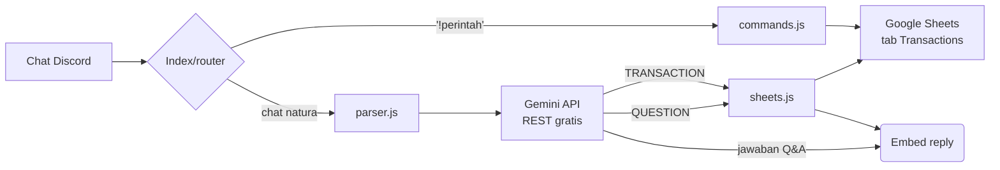

# PRD — Bot Pencatat Keuangan AI (Discord × Gemini × Google Sheets)

**Status:** v1.0 (MVP) · **Tanggal:** 2026-10-19 · **Kode proyek:** `pencatat_keuangan`

---

## 1. Ringkasan

Bot Discord yang mencatat keuangan dari **chat bahasa平常** ("bayar parkir 2 ribu") memakai AI
(Gemini API gratis), menyimpan hasilnya di **Google Sheets** (gratis, multi-user), dan bisa
**menjawab pertanyaan** tentang data keuangan user (total, margin, riwayat tanggal tertentu).

Prinsip utama: **semua komponen gratis**, konfigurasi seminimal mungkin, data tiap user terpisah.

## 2. Latar Belakang & Masalah

| Masalah | Solusi bot ini |
|---|---|
| Malas mencatat keuangan karena ribet buka aplikasi | Cukup ketik di aplikasi yang sudah terbuka (Discord) |
| Mencatat manual butuh ketelitian | AI menafsir dan me-rapikan: tipe, kategori, nominal |
| Tool premium berbayar / butuh database | 100% gratis: Discord, Gemini, Sheets |
| Data sulit dianalisis lanjutan | Semua data rapi di Google Sheets (bisa pivot/grafik sendiri) |

## 3. Tujuan (Goals)

| # | Goal | Metrik sukses |
|---|---|---|
| G1 | Catat transaksi dalam 1 chat | Chat cost → tersimpan < 5 detik |
| G2 | Paham format uang Indonesia | ≥ 90% tes kasus "2 ribu/15k/3 jt" terparsing benar |
| G3 | Rekap cepat | `!rekap` dibalas < 3 detik, angka cocok dengan Sheets |
| G4 | Bisa multi-user | Data user A tidak pernah muncul ke user B |
| G5 | Nol biaya operasional | Kuota free tier semua layanan tidak terlampaui |

## 4. Pengguna & User Stories

**Pengguna:** individual (keuangan pribadi) dan komunitas kecil (tiap anggota catat miliknya sendiri).

- **US1** — Sebagai user, saya menulis "bayar parkir 2 ribu" dan bot mencatatnya sebagai expense, karena saya tidak mau isi form.
- **US2** — Sebagai user, saya menulis "gajian 3 juta" supaya tercatat sebagai income.
- **US3** — Sebagai user, saya ketik `!rekap` untuk melihat pemasukan/pengeluaran/selisih bulan ini.
- **US4** — Sebagai user, saya ketik `!hapus 12` untuk membatalkan transaksi yang salah catat.
- **US5** — Sebagai user, saya bertanya "berapa total pengeluaran bulan ini", "berapa margin", "apa saja yang saya lakukan tanggal 3" dan dibalas AI memakai data saya sendiri.
- **US6** — Sebagai pemilik server, saya ingin bot hanya aktif di channel keuangan / saat di-mention, agar tidak riuh di channel lain.

## 5. Scope MVP (versi 1)

| ID | Fitur | Rincian |
|---|---|---|
| F1 | Deteksi transaksi | Kata kunci income (gajian/gaji/terima/bonus/dibayar/jual) vs expense (bayar/beli/belanja/isi/top up, default jika hanya nominal) |
| F2 | Parsing uang Indonesia | `2 ribu`=2000, `15k`=15000, `300rb`=300000, `2,5 jt`=2500000, `1.5k`=1500 |
| F3 | Kategori otomatis | Makanan, Transportasi, Belanja, Tagihan, Hiburan, Kesehatan, Pendidikan, Gaji, Bonus, Penjualan, Hadiah, Investasi, Donasi, Lainnya |
| F4 | Penyimpanan | Google Sheets tab `Transactions`, 1 tab terpusat + kolom `user_id` |
| F5 | Multi-user & privasi | Semua rekap/Q&A difilter per `user_id`; tidak bisa hapus transaksi orang lain |
| F6 | Perintah | `!rekap [hari\|1-12\|lalu\|all]`, `!hapus <id>`, `!help` |
| F7 | Q&A AI | Total income/expense, margin, riwayat hari/tanggal tertentu, daftar pengeluaran |
| F8 | Gating & rate limit | Hanya channel keuangan / mention; limit AI per user (default 8×/menit) |

## 6. Non-Goals (belum di MVP)

Dashboard web, OCR struk/bon foto, multi-currency lanjutan, budget & alert, ekspor PDF,
perintah slash command bawaan Discord, database lain selain Sheets, i18n selain Indonesia.

## 7. Kebutuhan Fungsional (detail penting)

### 7.1 Routing pesan
1. `author.bot` → abaikan.
2. Mulai `!` → perintah lokal (jangan pakai kuota AI).
3. Selain itu: diproses AI hanya jika berada di `MONEY_CHANNEL_ID` **atau** bot di-mention.
4. Pesan < 2 karakter setelah mention dibuang → abaikan.

### 7.2 Klasifikasi Gemini (JSON mode)
Schemanya ketat:
```json
{ "intent": "TRANSACTION"|"QUESTION"|"OTHER",
  "transaction_type": "EXPENSE"|"INCOME",
  "amount": 2000,
  "category": "Transportasi",
  "description": "Parkir" }
```
- `intent=OTHER` → bot balas contoh format, tidak menyimpan apa-apa.
- `intent=QUESTION` → pakai jalur Q&A (7.3), **bukan** menyimpan transaksi.

### 7.3 Q&A (pertanyaan data)
- Data dikumpulkan di Node (bukan AI): bulan ini (income/expense/selisih/margin), hari ini,
  pengeluaran per kategori, daftar max 150 transaksi terakhir user.
- AI hanya **menyusun jawaban** dari angka yang diberikan (menghindari halusinasi angka).
- Jawaban santai bahasa Indonesia, maks 10 kalimat.

### 7.4 Hapus transaksi
- ID transaksi = nomor baris di Sheets (footer reply bot memuatnya).
- `!hapus <id>`: harus milik user yang sama & status `OK`, mengubah `status` → `DELETED`.
- Tidak menghapus fisik barisnya: tetap jejak audit-nya.

## 8. Arsitektur



## 9. Model Data (Google Sheets — tab `Transactions`)

| Kolom | Isi | Contoh |
|---|---|---|
| A `timestamp` | `YYYY-MM-DD HH:mm:ss` Asia/Jakarta | `2026-10-19 21:05:00` |
| B `date` | `YYYY-MM-DD` | `2026-10-19` |
| C `user_id` | Discord snowflake | `1234567890123456789` |
| D `username` | username Discord | `macbook` |
| E `type` | `EXPENSE` / `INCOME` | `EXPENSE` |
| F `category` | lihat daftar kategori | `Transportasi` |
| G `description` | label singkat | `Parkir` |
| H `amount` | angka rupiah | 2000 |
| I `currency` | `IDR` | `IDR` |
| J `msg_id` | ID pesan Discord | `1122334455667788999` |
| K `status` | `OK` / `DELETED` | `OK` |

## 10. Keputusan Desain Penting

| Keputusan | Alasan |
|---|---|
| AI parsing + prompt rule, tanpa regex utama | Format gaya bahasa sangat variatif ("2 ribu parkir"), AI lebih fleksibel |
| Angka agregat dihitung di Node, bukan AI | Bebas halusinasi angka; konsisten dengan Sheets |
| 1 tab terpusat + kolom `user_id` | Mudah backup/pivot; tab baru per user tambah overhead setup |
| Gemini `thinkingBudget: 0` + respons JSON | Hemat kuota & latency untuk pemakaian chat kecil |
| Rate limit per user | Ada banyak penggemar → kuota gratis tidak habis 1 orang |
| Deploy di Render free + ping keep-alive | Gratis & tanpa Docker; UptimeRobot mencegah sleep |

## 11. Risiko & Mitigasi

| Risiko | Dampak | Mitigasi |
|---|---|---|
| Kuota Gemini habis | Bot gagal parse | Rate limit; free tier cukup utk PIM (± 15 rpm / 1500 rpd) |
| AI salah angka | Data keuangan kacau | Prompt few-shot; user bisa `!hapus` + embed preview sebelum save? (v2) |
| Service account bocor | Akses spreadsheet | .gitignore; hanya via file lokal/env; prinsip least access |
| Render sleep (15 m idle) | Bot "mati" | Ping keep-alive tiap 10 menit (UptimeRobot) |
| Bot merespons chat biasa | Spam / kuota AI boros | Hanya aktif di channel keuangan / saat di-mention |
| Data user tercampur | Masalah privasi | Semua query difilter `user_id`; cek pemilik saat `!hapus` |

## 12. Acceptance Criteria per Milestone

Rincian checklist ada di `TASKS.md` (sumber kebenaran progres). Ringkasan:

| Milestone | Buktinya jalan |
|---|---|
| M1 Bot online | Console "✅ Login berhasil" + `!help` dibalas |
| M2 Sheets aktif | `!rekap` dibalas "belum ada transaksi" tanpa error |
| M3 Parsing AI | "bayar parkir 2 ribu" tersimpan & reply embed dengan ID |
| M4 Perintah | `!rekap` angka cocok Sheets; `!hapus <id>` bekerja & menolak ID orang lain |
| M5 Q&A AI | 3 pertanyaan (total, margin, riwayat tanggal) terjawab memakai data user |
| M6 Deploy | Bot 24/7 di Render + README/panduan setup |
